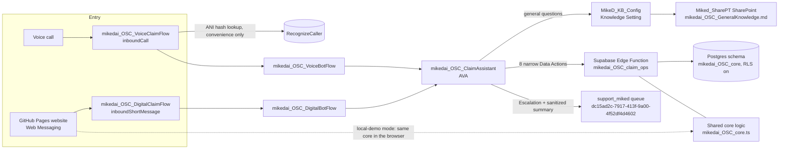
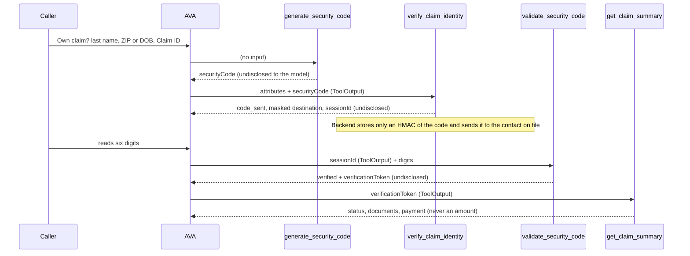

# Architecture

**Unofficial demonstration. Fictional data only.**

## Components

Voice, digital and the website share one business-logic module (`supabase/functions/_shared/mikedai_OSC_core.ts`) behind a `Store` port. `InMemoryStore` powers tests and the website's local-demo mode; `PgStore` powers Supabase.

## Verification journey (the security spine)

The type graph (`ToolOutput` mappings) makes it impossible for the model to call a claim tool without a token, or to send a code it did not generate. The code, session ID and token are `undisclosed`, so the model never sees them.

## Escalation

`create_service_case` (sanitized, allow-listed summary, verification state derived from the token) then the AVA **Escalation** event. The bot flow reads `handoff.case_id` and `handoff.summary`, sets participant data, and transfers to `Support_MikeD` (the queue whose ID is `dc15ad2c-7917-413f-9a00-4f52df4d4602`). Bot flows enable summarization and wrap-up assignment.

## Design decisions

| Decision | Why |
|---|---|
| 8 narrow Data Actions, each on a fixed URL path | AVA tools cannot pass constants and are limited to about 5 inputs, so a single `operation`-switch action cannot bind cleanly. Fixed paths give narrow, typed contracts and no operation switch exposed to the model |
| Deterministic steps consolidated server-side (verify = check + send, summary = status + documents + payment) | Fewer actions, fewer model decisions, fewer failure points |
| Claim-scoped lockout and resend counters | The AVA path does not carry a session on the first call, so session-only limits could be bypassed |
| Response allow-list per Genesys operation | Internal IDs, amounts and hashes cannot leak even if the store returns them |
| Quoted exact-case Postgres identifiers | Postgres lowercases unquoted names; the prefix must stay `mikedai_OSC_` |
| Schema `mikedai_OSC_core` not exposed through PostgREST, RLS on every table, no policies | Browsers cannot read protected tables; only the Edge Function (direct Postgres) can |

## Not built / known limits

See the final sections of [`security-and-privacy.md`](security-and-privacy.md) and [`test-plan.md`](test-plan.md).
